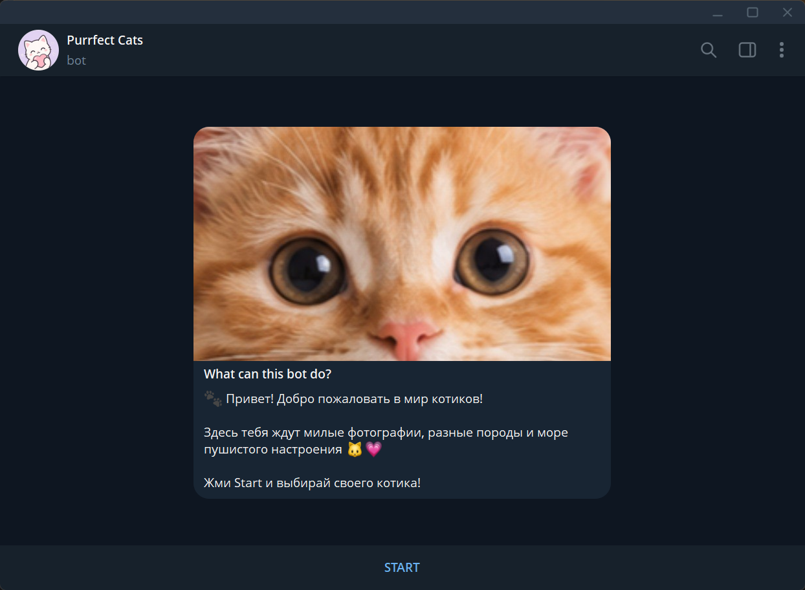
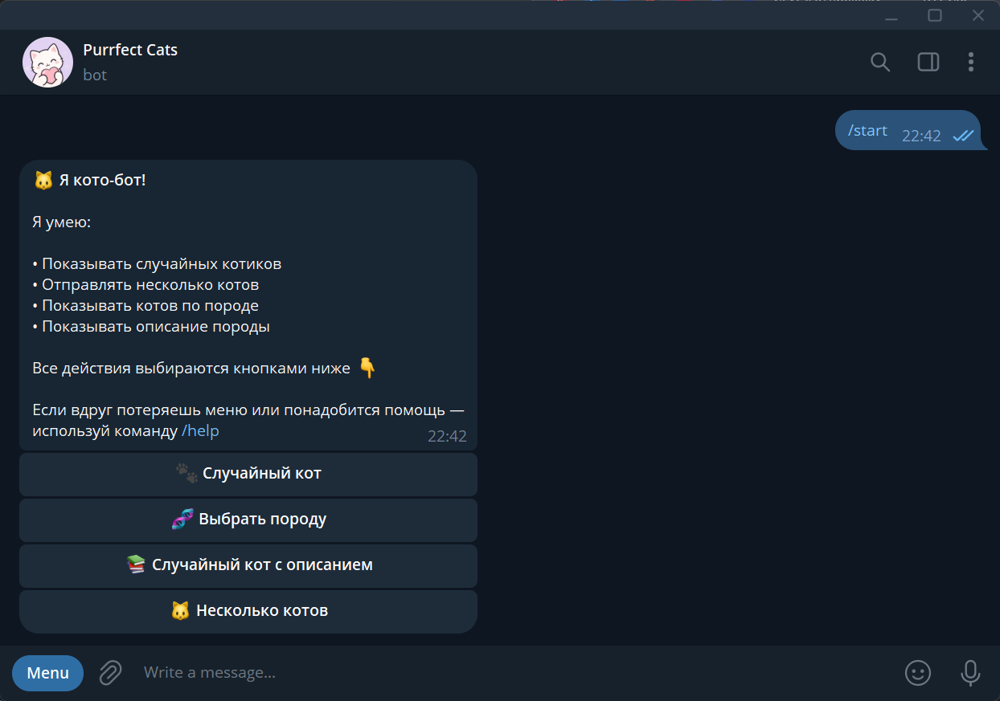
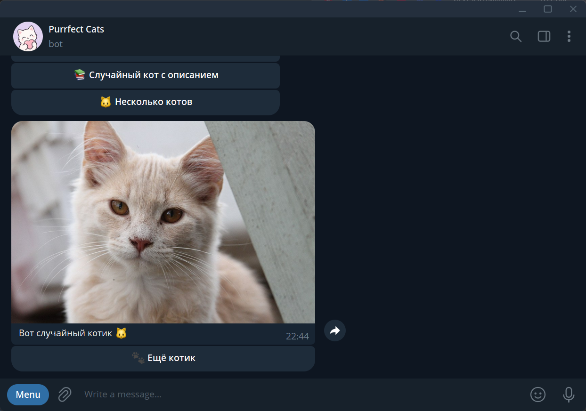
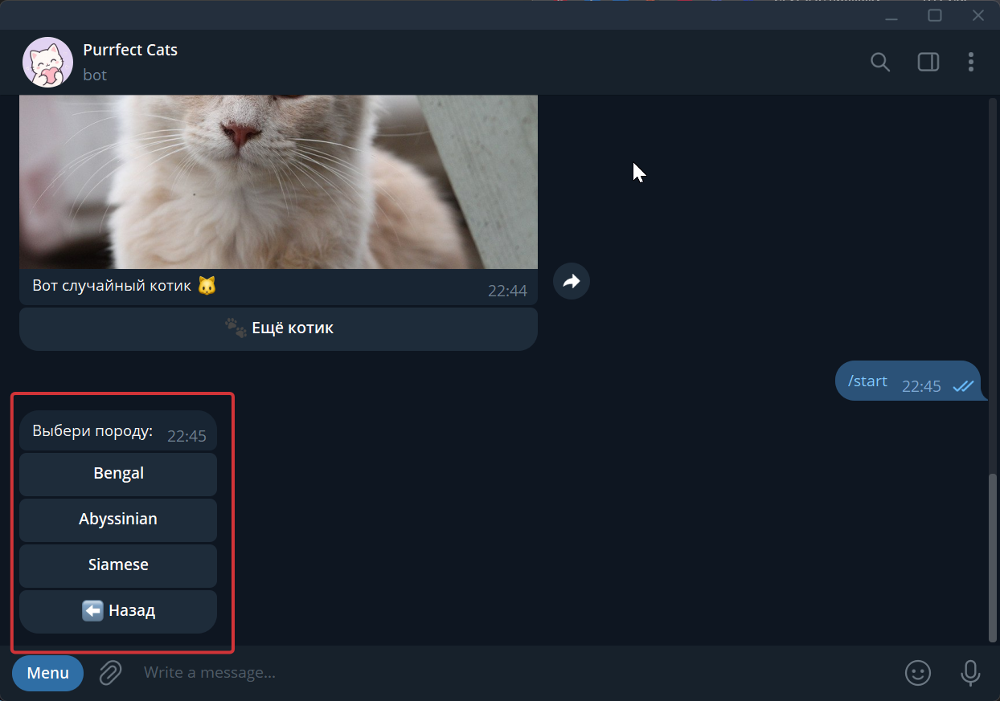
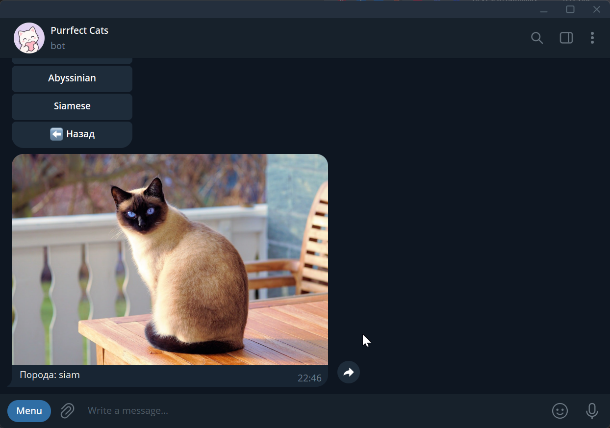
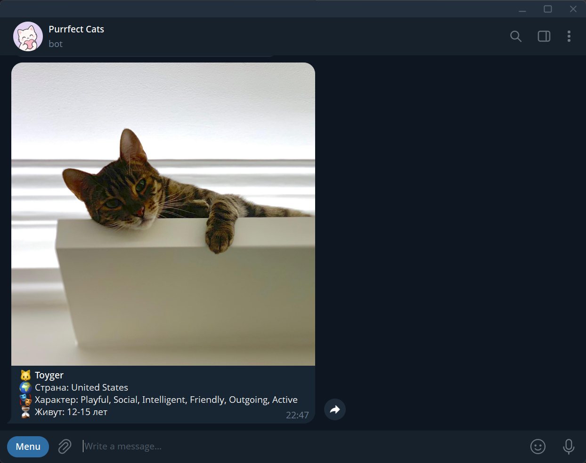
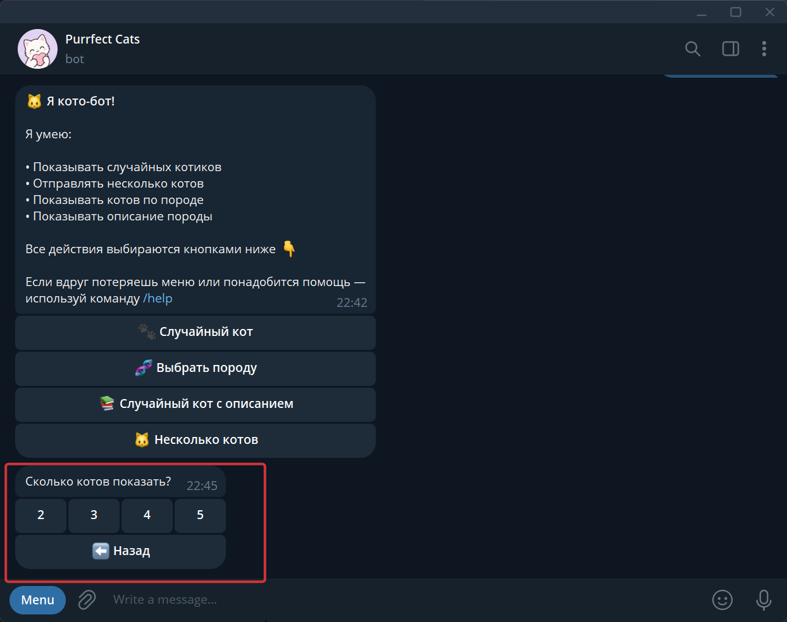
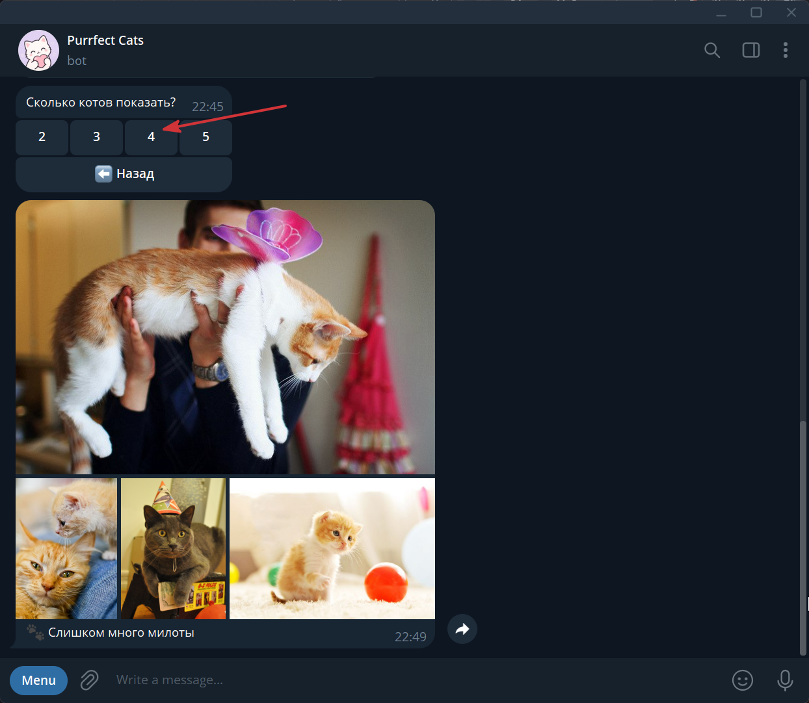

<h1 align="center">🐱 Purrfect Cat Bot</h1>

**Твоя ежедневная доза котиков, лапок и мурчания! 🐾**

Purrfect Cat Bot — Telegram-бот для поиска рандомных фотографий кошек, знакомства с разными породами и получения информации о них.

Бот использует [TheCatAPI](https://thecatapi.com/) для получения фотографий кошек и данных об их породах. Взаимодействие с ботом происходит через интерактивные кнопки в Telegram.

## Цель проекта

Цель проекта — создать интерактивного Telegram-бота и на практике применить знания Python, асинхронного программирования и работы с внешними REST API.

Проект также позволяет практиковаться в организации структуры приложения, работе с переменными окружения и обработке ошибок. В дальнейшем его можно дополнить.

## Стек технологий

| Технология       | Для чего используется                             |
| ---------------- | ------------------------------------------------- |
| Python 3.13      | Основной язык программирования                    |
| aiogram 3        | Работа с Telegram Bot API                         |
| asyncio          | Асинхронное выполнение операций                   |
| aiohttp          | Асинхронные HTTP-запросы                          |
| aiohttp-socks    | поддержка SOCKS-прокси для `aiohttp`              |
| python-dotenv    | Загрузка переменных окружения из `.env`           |
| TheCatAPI        | Получение фотографий кошек и информации о породах |
| Telegram Bot API | Взаимодействие с пользователями через Telegram    |

## Функционал

-  **Случайный котик** — получение случайной фотографии кошки.
    
-  **Выбор породы** — просмотр фотографий кошек выбранных пород.
	
-  **Информация о породе** — знакомство с происхождением, характером и продолжительностью жизни кошек.
    
-  **Несколько котиков** — отправка альбома из 2–5 фотографий.
    
-  **Интерактивное меню** — управление ботом с помощью inline-кнопок.
    
-  **Ещё котик** — получение новой фотографии одним нажатием.
    

## Скриншоты


### Главное меню

<p align="center">
  <a href="https://raw.githubusercontent.com/Tr-Veronika/telegram-bot-cats-pics/refs/heads/main/docs_screenshots/1_start_menu.png">
    
  </a>
  <a href="https://raw.githubusercontent.com/Tr-Veronika/telegram-bot-cats-pics/refs/heads/main/docs_screenshots/2_main_menu.png">
    
  </a>
</p>

### Случайный котик

[](https://raw.githubusercontent.com/Tr-Veronika/telegram-bot-cats-pics/refs/heads/main/docs_screenshots/3_random_cat.png)

### Выбор породы

<p align="center">
  <a href="https://raw.githubusercontent.com/Tr-Veronika/telegram-bot-cats-pics/refs/heads/main/docs_screenshots/4_breed_selection.png">
    
  </a>
  <a href="https://raw.githubusercontent.com/Tr-Veronika/telegram-bot-cats-pics/refs/heads/main/docs_screenshots/5_breed_selection.png">
    
  </a>
</p>

### Информация о породе

[](https://raw.githubusercontent.com/Tr-Veronika/telegram-bot-cats-pics/refs/heads/main/docs_screenshots/6_breed_info.png)


### Подборка котиков

<p align="center">
  <a href="https://raw.githubusercontent.com/Tr-Veronika/telegram-bot-cats-pics/refs/heads/main/docs_screenshots/7_cats_collection.png">
    
  </a>
  <a href="https://raw.githubusercontent.com/Tr-Veronika/telegram-bot-cats-pics/refs/heads/main/docs_screenshots/8_cats_collection.png">
    
  </a>
</p>

### Команда `/help`

[](https://raw.githubusercontent.com/Tr-Veronika/telegram-bot-cats-pics/refs/heads/main/docs_screenshots/docs_screenshots/9_command_help.png)

<br>

## Структура проекта

```
Telegram-Cat-Bot/
├── bot/
│   ├── handlers/
│   │   ├── __init__.py
│   │   ├── start.py
│   │   └── cats.py
│   ├── services/
│   │   ├── __init__.py
│   │   └── cat_api.py
│   ├── __init__.py
│   ├── config.py
│   ├── keyboards.py
│   └── texts.py
├── docs_screenshots/
│   └── screenshots.png
├── .env
├── .gitignore
├── main.py
├── requirements.txt
└── README.md
```

### Назначение основных файлов

- `main.py` — создание бота, регистрация команд и запуск обработки обновлений.
    
- `bot/config.py` — загрузка переменных окружения и настроек.
    
- `bot/handlers/` — обработчики команд, сообщений и нажатий на кнопки.
    
- `bot/services/cat_api.py` — отправка запросов к TheCatAPI.
    
- `bot/keyboards.py` — создание inline-клавиатур.
    
- `bot/texts.py` — тексты сообщений и подписи к фотографиям.
    
- `.env` — локальное хранение токенов и настроек.
    
- `requirements.txt` — список зависимостей проекта.
    
- `docs_screenshots/` — скриншоты для README.
    
<br>

## Установка и запуск

Инструкция предназначена для локального запуска бота на Windows, macOS или Linux.

### 1. Что понадобится

Перед началом убедиться, что установлены:

- Python 3.13 или совместимая версия
    
- Git
    
- Telegram
    
- IDE или редактор кода, например PyCharm или VS Code
    

Также понадобятся токен Telegram-бота и API-ключ TheCatAPI. Ниже описано, где их получить.

### 2. Клонирование репозитория

Открой терминал и выполни команду:

```bash
git clone https://github.com/Tr-Veronika/Telegram-Cat-Bot.git
```

Перейди в папку проекта:

```bash
cd Telegram-Cat-Bot
```

Если репозиторий находится по другому адресу, используй свою ссылку.

Также можно скачать проект архивом ZIP с GitHub и распаковать его вручную.

### 3. Создание виртуального окружения

Виртуальное окружение позволяет устанавливать зависимости отдельно для каждого Python-проекта.

Создай его командой:

```bash
python -m venv .venv
```

Если команда `python` не работает, попробуй `python3`:

```bash
python3 -m venv .venv
```

#### Активация виртуального окружения

Выбери команду в зависимости от своей операционной системы.

**Windows (PowerShell):**

```powershell
.venv\Scripts\Activate.ps1
```

**Windows (Command Prompt / CMD):**

```bat
.venv\Scripts\activate.bat
```

**macOS и Linux:**

```bash
source .venv/bin/activate
```

Если активация прошла успешно, в начале строки терминала появится `(.venv)`.

Если PowerShell запрещает выполнение скрипта активации, можно использовать CMD или запустить команды Python через `.venv` без активации окружения.

### 4. Установка зависимостей

Убедись, что виртуальное окружение активировано, и установи необходимые библиотеки:

```bash
python -m pip install -r requirements.txt
```

Если используешь команду `python3`, выполни:

```bash
python3 -m pip install -r requirements.txt
```

В проекте используются следующие зависимости:

```text
aiogram==3.31.0  
aiohttp==3.14.5  
python-dotenv==1.2.4  
aiohttp-socks==0.12.0
```

Они также перечислены в файле `requirements.txt`, поэтому вручную устанавливать каждую библиотеку не нужно.

### 5. Создание Telegram-бота и получение токена

Для работы бота необходимо получить токен через официальный сервис Telegram — BotFather.

1. Открой [@BotFather](https://t.me/BotFather) в Telegram.
    
2. Отправь команду `/newbot`.
    
3. Придумай отображаемое имя бота.
    
4. Придумай уникальный username, который заканчивается на `bot`.
    
5. Скопируй токен, который выдаст BotFather.
    

Если у тебя уже есть собственный бот, создавать новый необязательно — можно использовать его токен.

**Важно:** токен предоставляет доступ к управлению ботом. Не публикуй его в открытом репозитории и не отправляй посторонним.

### 6. Получение API-ключа TheCatAPI

Для получения фотографий кошек и информации о породах используется внешний сервис TheCatAPI.

1. Перейди на [официальный сайт TheCatAPI](https://thecatapi.com/).
    
2. Зарегистрируйся или войди в существующий аккаунт.
    
3. Получи API-ключ согласно инструкциям на сайте.
    
4. При необходимости ознакомься с [официальной документацией API](https://docs.thecatapi.com/).
    

Ключ передаётся в HTTP-заголовке `x-api-key`.

Доступность отдельных возможностей и ограничения запросов могут зависеть от условий использования сервиса.

### 7. Настройка переменных окружения

В корне проекта, рядом с `main.py`, создай файл `.env`.

Добавь в него следующие переменные:

```dotenv
BOT_TOKEN=твой_токен_telegram_бота
The_Cat_API=твой_api_ключ_thecatapi
PROXY_URL=
```

Замени примеры на свои значения:

- `BOT_TOKEN` — токен, полученный через BotFather.
    
- `The_Cat_API` — API-ключ с сайта TheCatAPI.
    
- `PROXY_URL` — необязательный адрес прокси-сервера (из-за ограничений ТГ в РФ, можно использовать прокси).
    

Если для подключения к Telegram тебе нужен прокси, укажи его адрес и порт. Например:

```
PROXY_URL=socks5://127.0.0.1:10808
```

Используй реальные настройки своего прокси. Если он не нужен, оставь значение пустым.

Файл `.env` не должен попадать в GitHub. Для этого в проекте предусмотрен `.gitignore`.

### 8. Запуск бота

Убедись, что виртуальное окружение активировано, а файл `.env` заполнен корректно.

Запусти приложение из корневой папки проекта:

```bash
python main.py
```

Если команда `python` недоступна, попробуй:

```bash
python3 main.py
```

Открой своего бота в Telegram и отправь команду:

```text
/start
```

После запуска должно появиться главное меню с кнопками для выбора доступных действий.

Чтобы остановить бота, нажми `Ctrl+C` в терминале.

### 9. Возможные проблемы

- **Python не найден.** Проверь установку Python и доступность команды `python` или `python3`.
    
- **Не удаётся активировать окружение.** Проверь команду для своей операционной системы или запусти Python через `.venv` напрямую.
    
- **Ошибка токена.** Убедись, что `BOT_TOKEN` указан правильно.
    
- **Ошибка API.** Проверь API-ключ, сетевое подключение и доступность TheCatAPI.
    
- **Telegram не подключается.** Возможно, сеть требует настройки прокси. Проверь `PROXY_URL` и убедись, что указанный прокси действительно работает.
